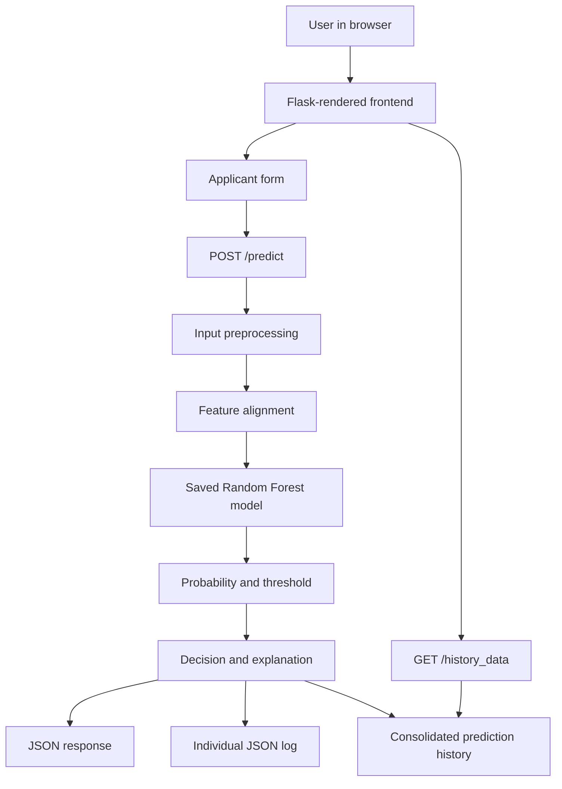

# Credit Card Approval Prediction System
## Detailed Project Documentation

> **Repository:** [isyedrayan1/credit-card-approval-prediction](https://github.com/isyedrayan1/credit-card-approval-prediction)  
> **Live demo (as linked in repository README):** https://credit-card-approval-prediction-envs.onrender.com/  
> **Project type:** Machine learning web application  
> **Primary stack:** Python, Flask, pandas, NumPy, scikit-learn, joblib, HTML, CSS, JavaScript, Jinja2, Gunicorn, Docker

---

## 1. Project Overview

The Credit Card Approval Prediction System is an educational machine-learning web application that estimates whether a submitted applicant profile should be classified as **Approved** or **Denied**. It exposes an interactive browser interface backed by a Flask API and a serialized Random Forest classifier.

Users enter applicant attributes such as age, employment status, income, education, family composition, and asset ownership. The backend converts those user-friendly fields into the feature representation expected by the trained model, obtains a prediction probability, compares that probability with a configured decision threshold, and returns a result with a human-readable explanation.

The application also records each prediction as JSON and exposes a history endpoint so the interface can show previous decisions.

**Important scope note:** This is a prototype/educational decision-support system, not a validated banking underwriting system. The application's labels and explanations should not be treated as actual financial advice or real-world credit eligibility decisions.

## 2. Problem Statement

Manual or rule-based pre-screening of applicants can be repetitive and difficult to make consistent. This project demonstrates how a trained classifier can process structured applicant data and produce a repeatable prediction through a web interface.

The core project problem is:

> Given a structured set of applicant profile attributes, predict the target approval class using a trained machine-learning model and present the result in an accessible web application.

The project demonstrates an end-to-end workflow: model training and serialization, input preprocessing, inference, result explanation, web presentation, and prediction logging.

## 3. Goals and Objectives

- Build an interactive web interface for applicant data entry.
- Standardize input preprocessing to align with model training features.
- Load a pre-trained Random Forest artifact and serve predictions through Flask.
- Return a probability and a threshold-based Approved/Denied result.
- Present a readable explanation of the decision.
- Keep a local JSON history of predictions and expose it to the interface.
- Provide dashboard, predictor, data-insights, and project-documentation pages.
- Support local execution and containerized deployment with Docker and Gunicorn.

## 4. Main Features

### 4.1 Dashboard
The home page introduces the application, links users to the predictor and data-insights page, and presents project/model information in a responsive card layout.

### 4.2 Applicant predictor
The predictor page collects an Applicant ID and profile attributes using form fields and dropdowns. It includes an autofill feature intended to make demonstrations and testing quicker.

The form converts data into a JSON request for the backend prediction route.

### 4.3 Machine-learning inference
The Flask application loads `models/random_forest.joblib` during startup. The saved artifact is expected to include:
- `model`: the trained classifier.
- `feature_columns`: the ordered feature names expected by the classifier.
- `threshold`: optional decision threshold, defaulting to `0.6` if missing.

The application calls `predict_proba` and compares the positive-class probability with this threshold to select the output class.

### 4.4 Human-readable reason report
The backend builds a text explanation using fields including annual income, employment status, employment tenure, number of children, and family size. The returned explanation is displayed alongside the prediction.

**Interpretability caution:** The reason text is assembled using hard-coded rules. It is not a formal explanation of the classifier's internal feature contributions, and may not fully correspond to the model's actual reasoning.

### 4.5 Prediction history
Each response is saved to an individual JSON file under `models/predictions/`, and appended to a consolidated `prediction_summary.json` file. The `/history_data` endpoint supplies the saved history for the interface.

### 4.6 Documentation and data-insights pages
The project contains dashboard, predictor, data-insights and project-documentation templates. The documentation portal can list Markdown files from `frontend/sample-docs/` and serve their contents through API endpoints.

### 4.7 Deployment support
A Dockerfile uses a Python 3.12 slim base image, installs packages from `requirements.txt`, copies the application, exposes port 5000 and launches Gunicorn with `main:app`.

## 5. Technology Stack

| Layer | Technology | Responsibility |
|---|---|---|
| Language | Python | Backend logic and model integration |
| Web framework | Flask | Routing, request handling, template rendering, JSON responses |
| Data processing | pandas, NumPy | Tabular input preparation and numerical transformations |
| Machine learning | scikit-learn | Classifier interface and model inference |
| Model persistence | joblib | Loading serialized estimator artifacts |
| Frontend templates | Jinja2 / HTML | Multi-page UI rendered by Flask |
| Styling | CSS | Responsive layout, visual components and styling |
| Client-side behavior | JavaScript | Form interaction, autofill, asynchronous requests and history |
| Production server | Gunicorn | WSGI process serving |
| Containerization | Docker | Packaging the application and runtime dependencies |
| Data persistence | JSON files | Local prediction logs |

The declared dependencies in `requirements.txt` include Flask, pandas, NumPy, scikit-learn, joblib and Gunicorn.

## 6. High-Level Architecture



### Request lifecycle

1. The browser renders the predictor page.
2. The user fills the applicant form or selects autofill.
3. The frontend submits applicant fields to `POST /predict` as JSON.
4. Flask validates that a payload and Applicant ID are present.
5. `prepare_input_record()` transforms the submitted values into the model's expected feature columns.
6. The loaded classifier produces a probability through `predict_proba()`.
7. The configured threshold converts the probability into an Approved/Denied label.
8. The backend builds a reason string and records the response.
9. Flask returns the prediction as JSON.
10. The page displays the output and can request stored history from `GET /history_data`.

## 7. Repository Structure

The key paths documented in the repository are:

```text
credit-card-approval-prediction/
├── main.py
├── README.md
├── requirements.txt
├── Dockerfile
├── .dockerignore
├── app/
│   ├── __init__.py
│   └── preprocess.py
├── frontend/
│   ├── base.html
│   ├── index.html
│   ├── predict.html
│   ├── docs.html
│   ├── project_docs.html
│   └── sample-docs/
├── static/
│   └── assets/
│       ├── image_landscape.png
│       ├── image_copy.png
│       └── chart images
├── models/
│   ├── random_forest.joblib
│   ├── decision_tree.joblib
│   ├── xgboost.joblib
│   ├── logistic_regression.joblib
│   └── predictions/
│       └── prediction_summary.json
├── data/
│   ├── application_record.csv
│   └── credit_record.csv
├── notebook/
│   └── training notebook / scripts
├── project documentation/
└── tests/
```

The tree above summarizes the main paths referenced by the README, backend, templates and Docker configuration. Some entries may differ by branch or deployment packaging; use the live repository tree as the source of truth.

### Important files

- **`main.py`**: Flask entry point; registers page/API routes, loads the Random Forest artifact, builds explanations and writes prediction logs.
- **`app/preprocess.py`**: transforms human-friendly form inputs and aligns the encoded row to `feature_columns`.
- **`frontend/base.html`**: shared page layout and global styling.
- **`frontend/index.html`**: dashboard.
- **`frontend/predict.html`**: prediction form, progress/result UI and history display.
- **`frontend/docs.html`**: data-insights and visual analysis page.
- **`frontend/project_docs.html`**: Markdown documentation portal.
- **`models/random_forest.joblib`**: primary inference artifact.
- **`models/predictions/`**: prediction logs stored by the running app.
- **`requirements.txt`**: Python dependencies.
- **`Dockerfile`**: container build and Gunicorn command.
- **`.dockerignore`**: excludes data, research notebooks, tests and several unused model files from the Docker build context.

## 8. Input Data and Feature Engineering

The preprocessing module expects a profile represented as a dictionary and creates a one-row pandas DataFrame. It engineers features and ensures the final encoded record matches the ordered feature list stored in the model artifact.

### 8.1 User-friendly fields

The UI collects understandable values such as:
- Applicant ID
- Gender
- Car ownership
- Real-estate ownership
- Annual income
- Number of children
- Number of family members
- Age in years
- Employment status
- Years employed
- Income type, education, family status, housing type and occupation where provided by the form

The precise submitted fields depend on the current form template.

### 8.2 Age and employment transformation

The preprocessing implementation converts age in years to a negative `DAYS_BIRTH`-style value using approximately 365.25 days per year.

For employed applicants, years employed are converted into a negative `DAYS_EMPLOYED`-style value. For the unemployed case, the code uses the sentinel value `365243`, which is used by this dataset convention to indicate an unavailable/exceptional employment duration.

The code then derives `AGE`, `EMPLOYED` and `YEARS_EMPLOYED`.

### 8.3 Derived income ratio

The preprocessing module calculates `INCOME_EMPLOY_RATIO`. When employment tenure is greater than zero, this is annual income divided by years employed; otherwise, the income amount is used directly. This fallback should be reviewed before treating the feature as financially meaningful.

### 8.4 Credit-history features

The code fills the following features with zero if they were not included in the input:
- `STATUS_MAX`
- `STATUS_MIN`
- `STATUS_MEAN`
- `STATUS_LAST`
- `STATUS_TREND`
- `NUM_LATE_MONTHS`

This is a simplification: zero-valued defaults do not prove an applicant has a clean credit history. A real system should distinguish missing history from observed good history and should define an explicit strategy for new-to-credit applicants.

### 8.5 Categorical encoding and column alignment

The preprocessing code applies one-hot encoding to categorical columns such as gender, car ownership, realty ownership, income type, education type, family status, housing type and occupation. It then converts the encoded DataFrame to numeric values and reindexes it to the model's saved feature column list, filling absent columns with zero.

**Model-consistency requirement:** Training and production inference must use identical preprocessing decisions, category handling, feature definitions and column order. A versioned scikit-learn pipeline is usually safer than maintaining separate training and inference transformations.

## 9. Model and Decision Logic

### 9.1 Model loading

At startup, the application expects the Random Forest artifact at:

`models/random_forest.joblib`

If the artifact is missing, the application raises a `FileNotFoundError` and stops. The code loads the artifact with joblib and retrieves its model, feature columns and optional threshold.

Only load joblib/pickle-style artifacts from trusted sources because deserialization can execute code.

### 9.2 Prediction

The core logic is equivalent to:

```python
probability = model.predict_proba(features_df)[0, 1]
threshold = artifact.get("threshold", 0.6)
prediction = int(probability >= threshold)
decision = "Approved" if prediction == 1 else "Denied"
```

The returned probability is rounded to four decimal places in the response. This probability is a model score, not automatically a calibrated probability of actual default or approval.

### 9.3 Explanation generation

The `build_reason()` function uses secondary hard-coded thresholds, including a $120,000 income check and a two-year employment-tenure check, along with household size checks. It concatenates these into a human-readable string.

These rules should not be assumed to be the model's learned decision boundaries. The thresholds may not be in the same units as a user's local currency and may not reflect a bank's underwriting policy. For trustworthy explanations, use a validated explanation method and ensure that each displayed reason is supported by the actual model and data.

### 9.4 Model-performance figures in the UI

The dashboard displays classifier metrics such as 100% accuracy for tree-based models and describes the target labels as being generated from deterministic heuristics. These figures are claims displayed by the app's UI, not independently verified evaluation results in this document.

If labels are generated from deterministic rules, a model can reproduce those rules with very high accuracy without proving that it can predict real-world credit outcomes. Before presenting performance figures as evidence of production quality, document the dataset split, data leakage checks, class distribution, confusion matrix, calibration, fairness analysis and a genuinely held-out evaluation.

## 10. Flask Routes and API

| Route | Method | Purpose |
|---|---|---|
| `/` | GET | Render dashboard |
| `/predictor` | GET | Render applicant predictor |
| `/docs` | GET | Render data-insights page |
| `/predict` | POST | Validate input, preprocess, predict, explain and log result |
| `/history_data` | GET | Return saved prediction history |
| `/portal` | GET | Render documentation portal |
| `/api/project-docs/list` | GET | List Markdown files from the sample-docs directory |
| `/api/project-docs/file?path=<filename>` | GET | Read a requested Markdown file from the documentation directory |

### `POST /predict`

The route expects a JSON object containing an `ID` field and the values needed by preprocessing. If the input is missing or does not contain `ID`, the route responds with HTTP 400. On successful inference it returns fields including:
- `timestamp`
- `applicant_id`
- `prediction`
- `probability`
- `reason`
- `input_data`

If inference or logging raises an exception, it responds with HTTP 500 and an error message.

### `GET /history_data`

Returns an object with a `predictions` array. Existing history is returned in reverse order, so the latest records appear first. When the summary file is absent, the endpoint returns an empty array.

### Documentation portal endpoints

The listing endpoint reads Markdown files from the sample documentation directory. The file endpoint rejects empty paths, path traversal patterns and paths outside the intended directory, then returns Markdown as text. The route still needs careful deployment review and tests for platform-specific path handling and symbolic-link edge cases.

## 11. Prediction Storage

The project writes two kinds of records:
1. One JSON file per applicant/prediction, using a filename pattern such as `prediction_<ID>.json`.
2. A consolidated `prediction_summary.json` containing the total number of predictions, the latest result and the full prediction list.

This persistence approach is easy to understand for a local demo but has important limitations:
- Concurrent requests can overwrite one another's updates to the shared summary file.
- The log grows indefinitely.
- Local container files may be ephemeral or not shared across multiple application instances.
- Applicant identifiers and inputs may be sensitive; storage needs access controls, retention rules and appropriate data minimization.
- A repeated ID may overwrite the individual record for that ID even though the consolidated summary receives another entry.

A database such as PostgreSQL with transactions and explicit retention policies is more suitable for multi-user deployment.

## 12. Local Setup and Execution

### Prerequisites
- Python 3.12 is the version used by the Docker base image.
- Git
- pip
- The trained model artifact under `models/random_forest.joblib`

### Clone

```bash
git clone https://github.com/isyedrayan1/credit-card-approval-prediction.git
cd credit-card-approval-prediction
```

### Create and activate a virtual environment

Windows PowerShell:

```powershell
python -m venv .venv
.\.venv\Scripts\Activate.ps1
python -m pip install --upgrade pip
```

macOS/Linux:

```bash
python3 -m venv .venv
source .venv/bin/activate
python -m pip install --upgrade pip
```

### Install dependencies

```bash
pip install -r requirements.txt
```

### Verify the model file

Confirm that `models/random_forest.joblib` exists. The startup code explicitly requires it. The README refers to a training notebook, but the exact available training path should be checked in the repository's current branch before running training commands.

### Start Flask

```bash
python main.py
```

Then open:

`http://127.0.0.1:5000`

The app's development entry point binds to `127.0.0.1` and enables Flask debug mode. Do not use the debug server for production.

## 13. Docker Deployment

Build the image:

```bash
docker build -t credit-approval-app .
```

Run the container:

```bash
docker run --rm -p 5000:5000 credit-approval-app
```

Then open `http://127.0.0.1:5000`.

The Dockerfile launches:

```bash
gunicorn --bind 0.0.0.0:5000 main:app
```

Before deployment, ensure all runtime assets required by the application are included in the container. The `.dockerignore` excludes raw data and notebooks, so retraining inside the built image is not the intended deployment workflow. The trained model and static assets must be available where the application expects them.

## 14. Testing Strategy

A complete test suite should cover the following areas.

### Unit tests
- Age-to-days conversion.
- Employment status and employment duration mapping.
- Missing categorical values and occupation fallback.
- Derived feature calculations.
- One-hot encoding and model feature-column alignment.
- Behavior for empty, malformed and out-of-range values.
- Reason generation for Approved and Denied cases.

### API tests
- Dashboard and page routes return HTTP 200.
- `POST /predict` rejects missing JSON or Applicant ID.
- Valid requests return the expected response keys.
- Model errors produce a controlled HTTP 500 response.
- `GET /history_data` works when no history exists and when history is populated.
- Documentation listing and file-reading routes handle missing files and invalid paths.

### Model evaluation
- Keep preprocessing and model training separated from held-out test data.
- Check duplicates and leakage between training and evaluation.
- Record confusion matrix, precision, recall, F1, ROC-AUC and precision-recall performance where appropriate.
- Check calibration and decision-threshold sensitivity.
- Evaluate subgroup performance and possible disparate impact before any real-world use.

The existence and completeness of tests should be verified in the repository; this section describes the recommended test plan, not a claim that all of these tests currently exist.

## 15. Security, Privacy and Responsible Use

Applicant information can be sensitive. Before using the project with real data:
- Do not collect or store more personal information than necessary.
- Use authentication and role-based access if the app is not strictly local.
- Avoid exposing detailed applicant data or prediction history to unauthenticated users.
- Replace unbounded JSON logs with secure persistence, retention and deletion controls.
- Do not return raw internal exception messages in production.
- Disable Flask debug mode in production.
- Add request validation, numeric bounds, rate limiting and monitoring.
- Use HTTPS at the deployment edge.
- Pin dependencies and scan them for vulnerabilities.
- Review model artifact provenance before loading it.
- Define an appeal/review workflow and avoid making adverse financial decisions solely from an unvalidated automated output.

## 16. Known Limitations and Items to Verify

These are material concerns visible from the code and repository documentation:

1. **Synthetic or heuristic labels:** The UI states that labels were generated from deterministic rules. High scores may show that the model learned those rules, not that it generalizes to real credit approval.
2. **Hard-coded explanation thresholds:** The narrative uses fixed values such as $120,000 annual income and two years employed. These do not constitute model-faithful explanations.
3. **Default credit-history values:** Several credit-history features default to zero when absent, which can make missing information look like a clean record.
4. **File-based concurrent logging:** Shared JSON writes can race and are not a robust multi-worker database.
5. **Sensitive history:** The prediction-history endpoint appears designed to expose logs to the web interface. It should be protected if real applicant data is used.
6. **Probability interpretation:** A class probability from a classifier should not be presented as a calibrated real-world approval probability without measurement.
7. **Feature/data consistency:** One-hot encoding at inference must exactly match training. The artifact's saved feature columns help, but a unified persisted pipeline would reduce drift.
8. **Unit/currency clarity:** The UI labels income as dollars, and explanation text uses dollar thresholds. These units should match the dataset and target market.
9. **Performance claims:** The metrics shown in the dashboard need reproducible experiment details and an independent leakage review.
10. **Production readiness:** A Dockerfile and live demo do not by themselves make the system production-ready for regulated credit decisions.

## 17. Recommended Improvements

### Priority 1: Correctness
- Package the full preprocessing and classifier into one scikit-learn Pipeline.
- Add schema validation for all required inputs and meaningful value ranges.
- Separate missing credit history from a genuinely good history.
- Verify every input form field maps to the training schema.
- Make income units/currency explicit and consistent.
- Re-run evaluation after checking synthetic-label generation and potential leakage.

### Priority 2: Reliable storage and security
- Replace JSON history files with a database and transactions.
- Add authentication and access control around prediction history.
- Add data deletion and retention policies.
- Make production errors safe and informative without exposing internals.
- Add tests and continuous integration.

### Priority 3: ML quality and responsible presentation
- Add calibrated scores and threshold analysis if probability is shown.
- Document dataset origin, license, label definition and class balance.
- Include subgroup evaluation and fairness checks.
- Use SHAP or another appropriate explainability tool only after validating its assumptions, and distinguish explanation from causal reasoning.
- Display a clear prototype disclaimer in the interface.

### Priority 4: Maintainability
- Add structured logs and monitoring.
- Pin dependency versions.
- Version model artifacts and record training metadata.
- Add reproducible training scripts and a documented model refresh process.
- Ensure container builds and deployment smoke tests run automatically.

## 18. Future Scope

Potential extensions include:
- A secure staff/admin dashboard with role-based access.
- Database-backed application records and audit trails.
- Batch scoring for approved CSV uploads.
- Versioned model management and drift monitoring.
- A review queue for uncertain or borderline predictions.
- Explainability reports based on validated methods.
- Model cards documenting data provenance, intended use, limitations and evaluation.
- Accessibility improvements and localization for the intended market.
- Automated CI tests and deployment checks.

## 19. Conclusion

The repository implements a full-stack ML prototype for credit-card approval prediction: Flask routes, a Jinja2 frontend, preprocessing logic, a serialized Random Forest model, threshold-based classification, generated explanations and JSON prediction history. It is suitable for demonstrating the application lifecycle of a machine-learning model.

The main gap before any consequential use is validation, not the interface. The data and labels, evaluation process, fairness, probability calibration, explanation fidelity, data security and persistence model must all be improved and independently tested before the system can be treated as a dependable credit decision tool.

---

## Repository References

- [Repository](https://github.com/isyedrayan1/credit-card-approval-prediction)
- [README](https://github.com/isyedrayan1/credit-card-approval-prediction/blob/main/README.md)
- [Flask entry point](https://github.com/isyedrayan1/credit-card-approval-prediction/blob/main/main.py)
- [Preprocessing module](https://github.com/isyedrayan1/credit-card-approval-prediction/blob/main/app/preprocess.py)
- [Predictor page](https://github.com/isyedrayan1/credit-card-approval-prediction/blob/main/frontend/predict.html)
- [Dashboard page](https://github.com/isyedrayan1/credit-card-approval-prediction/blob/main/frontend/index.html)
- [Requirements](https://github.com/isyedrayan1/credit-card-approval-prediction/blob/main/requirements.txt)
- [Dockerfile](https://github.com/isyedrayan1/credit-card-approval-prediction/blob/main/Dockerfile)
